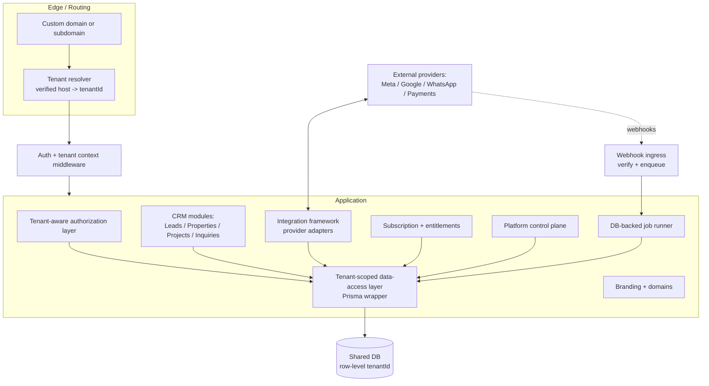
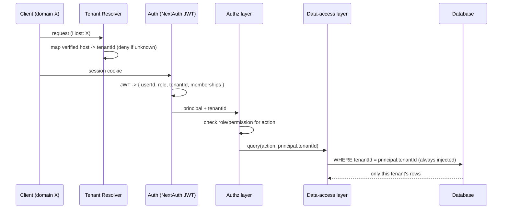
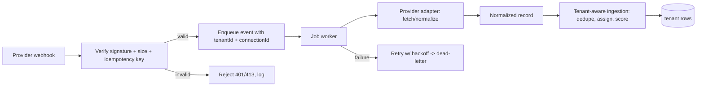

# Master Architecture Audit — Multi-Tenant White-Label CRM SaaS

**Scope:** read-only audit and design. No source, schema, migration, env, or deployment changes were made.
**Repository:** PlotsnHomes CRM (`RealEstate_NewDb`), branch `main`.
**What was inspected (verified):** `prisma/schema.prisma` (full, 54 models/enums), `src/lib/roles.ts`, `src/middleware.ts`, `src/lib/crm-access.ts`, `src/lib/admin-api.ts`, `src/lib/auth-options.ts`, `src/lib/system-settings.ts`, the Phase 1/1.1 security code (`credentials-crypto.ts`, `meta-webhook.ts`, `readiness.ts`, `enc-key-status.ts`, `instrumentation.ts`), lead pipeline (`lead-channels.ts`, `inbound-lead.ts`, integration webhook routes), and an inventory of routes/integrations/jobs/storage.
**What remains unreviewed:** the bodies of the ~123 individual API route handlers were not each read end-to-end (I inventoried them and read the representative/critical ones). A full per-route authorization audit is itemized as Phase A work in the roadmap.
**Labelling:** **[VERIFIED]** = read in the code; **[ASSUMPTION]** = inferred, not confirmed; **[UNKNOWN]** = needs your input or a test.

---

## Deliverable A — Executive summary

### What the application currently is
A **single-tenant, role-based real-estate CRM** built as a Next.js 14 App Router modular monolith with Prisma + SQLite (dev) / MySQL (prod), NextAuth v4 (JWT credentials), and a rich domain model (properties, projects/developers, leads, inquiries, transactions, commissions, KYC, loans, messaging). It already contains an **organization hierarchy** (Organization → Franchise → Branch → Department → Team → User) and the beginnings of tenant vocabulary: `User.tenantId → Organization`, an `Organization.domain` / `whiteLabelAdminId` / `status`, and platform-vs-white-label roles. **[VERIFIED]**

Crucially, this vocabulary is **not wired into data access**. The org hierarchy is used for *assigning* users in the admin UI, not for *isolating* data. There is today **no real tenant isolation**.

### What must change to become a genuine multi-tenant SaaS
1. Promote **Organization to the formal tenant root** (it already is, de facto) and give **every tenant-owned business record a `tenantId`** (direct, not derived) — Lead, Property, Project, Developer, Inquiry, Transaction, LeadActivity, LeadTask, AgentCommission, KycProfile, LoanApplication, PropertyShowing, MessageLog, MeetingInvite, EmailLog, InboundLeadLog, BulkJob, CrmGoal, BrokerageInvoice, UserActivity, etc.
2. Build a **central tenant-resolution + authorization layer** that every read/write/update/delete/export/report/webhook/job passes through. Put `tenantId` into the **JWT/session** and enforce it server-side.
3. Replace the global **`SystemSetting` key/value store** and the global **`lead_channels`** config with **per-tenant** configuration and per-tenant integration connections.
4. Separate **platform billing (tenant → platform)** from the existing **end-user `UserSubscription`** (which is a different product concept) and add plan/entitlement/quota enforcement.
5. Add a **provider-neutral integration framework** (connections, credentials, webhooks, retries, logs) so Meta is one adapter among many.
6. Add **white-label branding + custom-domain resolution** that never trusts the raw Host header.
7. Add **background processing, observability, migration tooling, and tenant-isolation tests** before launch.

### Top risks (most important first)
| # | Risk | Severity |
|---|---|---|
| 1 | **No tenant isolation on business data.** `leadScopeForUser()` returns `{}` (no filter) for every manager role; a `WHITE_LABEL_ADMIN` sees **all tenants' leads**. Other entities have no scoping at all. | **Critical** |
| 2 | **Session has no tenant context.** JWT carries only `id` + `role`; there is nothing to filter queries by, so isolation cannot be enforced even where code tries. | **Critical** |
| 3 | **Global integration credentials.** `lead_channels` (Meta/Google/portal secrets) live in one global `SystemSetting`; all tenants would share one Meta app/token. | **Critical** |
| 4 | **Business entities lack `tenantId`.** Ownership is only derivable (and sometimes not at all, e.g. `Project`/`Developer`), so backfill is ambiguous. | **Critical** |
| 5 | **`middleware.ts` is not an auth gate** — it only sets a header; route protection depends on each handler. ~37 of 123 API routes do not call a session helper (some legitimately public). | **High** |
| 6 | **Billing ≠ access state.** `UserSubscription` is per-user and plan-less for tenants; no platform-plan entitlements or quotas; nothing stops client-side feature bypass. | **High** |
| 7 | **Schema/migration drift.** 5 committed migrations (last `20260630…`) predate dozens of models now added via `prisma db push`; dev=SQLite vs prod=MySQL generated at build. A clean migrate would not reproduce prod. | **High** |
| 8 | **No background jobs/queue.** Webhooks, imports, token refresh run inline; no retries/dead-letter; tenant context cannot be propagated to async work that doesn't exist yet. | **Medium** |
| 9 | **`/icon` build failure** (reproduced): `@vercel/og` `fileURLToPath` rejects the project path (contains space+comma). Environmental, but blocks a clean `next build` today. | **Medium** |
| 10 | **No observability / audit trail** for cross-tenant events, integration failures, or security events. | **Medium** |

### Recommended overall architecture
A **shared modular monolith** (keep the current Next.js app) with:
- **Organization = Tenant root.** One shared DB, strict row-level `tenantId` scoping enforced by a **tenant-aware data-access layer** (a thin Prisma wrapper / repository), not scattered `where` clauses.
- **Tenant resolved server-side** from the authenticated user's membership (and, for custom domains, from a verified domain→tenant map) — never from a client-supplied id or raw Host header.
- **Provider-neutral integration framework** with per-tenant connections and encrypted credentials (reusing the Phase 1 AES-256-GCM work, re-keyed per tenant context).
- **Platform control plane** (separate authorization boundary) for tenant lifecycle, plans, entitlements, domains, and audited support access.
- **DB-backed job runner** (no Redis initially) for webhooks/imports/retries.

Do **not** move to microservices or per-tenant databases now; nothing in the evidence justifies that operational cost.

### Decisions needed before implementation (detail in Deliverable J)
1. **Organization as tenant root vs. new `Tenant` model** → recommend reuse Organization.
2. **Tenant attribution of existing data** (whose records are whose?) → needs your rules; dry-run first.
3. **Platform billing provider & model** (Razorpay is already integrated for INR) → recommend start with Razorpay subscriptions, keep provider-abstracted.
4. **Custom-domain hosting reality on Hostinger** → likely needs a reverse proxy/edge in front; confirm before promising wildcard TLS.
5. **Is the current data one tenant or many?** → determines whether migration is trivial (wrap all in one org) or requires attribution.

---

## Deliverable B — Verified current-state inventory

### Confirmed technologies & versions **[VERIFIED from `package.json`]**
- Next.js **14.2.35** (App Router), React **^18**, TypeScript **^5**, Tailwind **^3.4**.
- Prisma **^6.19.3**; `datasource` provider **sqlite** (dev). Prod MySQL via `scripts/generate-mysql-schema.mjs` + `build:hostinger`.
- NextAuth **^4.24** (JWT strategy, Credentials provider).
- Payments: `razorpay ^2.9`, `stripe ^22.1`. Email: `resend`, `nodemailer`. Messaging: `whatsapp-web.js ^1.34` (+ puppeteer, kept external). Files: `cloudinary ^2.10`. Misc: `xlsx`, `zod ^4`, `qrcode`, `country-state-city`.
- Test tooling: **`tsx` only** (no vitest/jest). `npm test` runs the Phase 1/1.1 security suite via tsx.
- No queue/cron/Redis dependencies. **[VERIFIED]**

### Data model (54 models/enums in `prisma/schema.prisma`) **[VERIFIED]**
- **Org hierarchy:** `Organization`, `Franchise`, `Branch`, `Department`, `Team` (each with a `*AdminId/ManagerId/HeadId/LeaderId` → User, `status` default `ACTIVE`, parent FK `onDelete: SetNull`).
- **Users:** `User` has `role`, `tenantId → Organization` (relation "UserOrganization"), `franchiseId/branchId/departmentId/teamId`, `managerId` self-relation, `hierarchyLevel`, `dataScope` (default "OWN").
- **Business:** `Property`, `Project`, `Developer`, `Lead`, `Inquiry`, `Transaction`, `LeadActivity`, `LeadTask`, `AgentCommission`, `PropertyShowing`, `KycProfile`, `LoanApplication`, `BrokerageInvoice`, `CrmGoal`, `UserActivity`, `ActivityComment`, `Favorite`, `MeetingInvite`, `MessageLog`, `EmailLog`, `BulkJob`, `PropertyPriceLog`, `PropertyCategory`, `RatingSlab`, `CustomFieldDef`.
- **Settings/ops:** `SystemSetting` (global key/value), `InboundLeadLog`.
- **Subscription (end-user):** `SubscriptionPlan` (interval, price, `targetRole` BUYER/INVESTOR/AGENT), `UserSubscription` (per-**user**, Stripe id).

### Security controls already implemented (Phase 1/1.1) **[VERIFIED]**
- AES-256-GCM credential encryption (`credentials-crypto.ts`), per-op IV, fail-safe decrypt, key via `CREDENTIALS_ENC_KEY`.
- Masked integration config APIs; secret-preserving merge on update.
- Meta webhook HMAC-SHA256 over raw body, timing-safe compare, prod fail-closed on missing App Secret, size guards (`meta-webhook.ts`); timing-safe compares for portal/google secrets.
- Migration + key-rotation scripts (counts only, backups, env-target guard).
- Startup readiness gate (`instrumentation.ts`) + admin readiness probe; 21/21 security tests pass.

### Known bugs / build blockers **[VERIFIED]**
- `next build` fails prerendering `/icon` (`src/app/icon.tsx` via `@vercel/og`) — `fileURLToPath: Invalid URL` because the project folder path contains a space and comma. Compilation + typecheck pass; only this route export fails. See Module 14.
- Schema/migration drift (see Risk 7).

### Missing capabilities (for SaaS) **[VERIFIED by absence]**
No tenant-scoped queries, no tenant in session, no per-tenant settings/integrations, no platform billing/entitlements, no custom-domain resolution, no branding store, no job queue, no observability/audit layer, no tenant-isolation tests.

---

## Deliverable C — Target architecture

> Default: **modular monolith**, shared DB, row-level tenant scoping. Microservices are explicitly not recommended now.

### Logical architecture (Mermaid)


### Request / auth / tenant-resolution / authorization flow


### Integration event-processing flow


### Other flows (described)
- **Subscription/entitlement:** payment-provider webhook (verified) → update tenant `Subscription` state → recompute `Entitlements` (features/quotas) → access layer reads entitlements per request; **client flags never grant access**.
- **Tenant lifecycle:** `PENDING → ACTIVE → PAST_DUE → SUSPENDED → CANCELLED → (retention window) → DELETED`. Each transition is audited; suspension disables login/API/jobs/integrations but **preserves data**.
- **Database ownership model:** see Deliverable D.

### Module / service breakdown
Tenant & membership · Authz/data-access · CRM (leads/properties/projects/inquiries) · Integration framework + adapters · Billing/entitlements · Branding/domains · Platform control plane · Jobs · Observability/audit. All in one deployable.

---

## Deliverable D — Database design (model-by-model change plan)

> No migrations generated or applied here. Ownership classes: **G**=platform-global, **T**=tenant-owned (direct `tenantId`), **D**=tenant-derived (via parent), **U**=user-owned, **I**=integration-owned, **O**=audit/operational.

### New / promoted models
| Model | Purpose | Key fields | Notes |
|---|---|---|---|
| `Organization` → **Tenant root** | existing; formalize | add `plan`/`subscriptionId` link, keep `domain`,`status`,`whiteLabelAdminId` | Reuse; do **not** add a parallel `Tenant`. |
| `TenantMembership` *(new, recommended)* | user↔tenant with role | `userId`,`tenantId`,`role`,`status` | Enables a user in >1 tenant later; near-term `User.tenantId` may suffice (see J-1). |
| `IntegrationProvider` *(new, G)* | provider registry | `key`,`name`,`authType`,`capabilitiesJson` | Platform-global catalog. |
| `IntegrationConnection` *(new, T/I)* | per-tenant connection | `tenantId`,`providerKey`,`status`,`encryptedCredsJson`,`scopesJson`,`externalAccountId` | Replaces global `lead_channels`. Encrypted at rest (Phase 1 crypto). |
| `WebhookEvent` *(new, O)* | idempotency + replay guard | `tenantId?`,`providerKey`,`externalId`,`signatureVerified`,`status`,`receivedAt` | Unique `(providerKey, externalId)`. |
| `Subscription` *(new, T)* | **tenant→platform** billing | `tenantId`,`planId`,`status`,`period*`,`providerRef` | Separate from `UserSubscription`. |
| `PlanEntitlement` *(new, G/T)* | features/quotas | `planId`,`featureKey`,`limitInt` | Server-enforced. |
| `TenantBranding` *(new, T)* | white-label | `tenantId`,`logoUrl`,`colorsJson`,`productName`,`emailFromJson` | |
| `CustomDomain` *(new, T)* | domains | `tenantId`,`host`(unique),`verifiedAt`,`tlsStatus` | Host→tenant map; collision-safe. |
| `Job` *(new, O)* | DB-backed queue | `tenantId?`,`type`,`payloadJson`,`status`,`attempts`,`runAfter`,`lockedAt` | |
| `AuditEvent` *(new, O)* | sensitive actions | `tenantId?`,`actorId`,`action`,`targetType`,`targetId`,`metaJson`,`createdAt` | No secrets/PII values. |

### Existing models — required ownership
| Model | Class | Change |
|---|---|---|
| `Lead`, `Property`, `Project`, `Developer`, `Inquiry`, `Transaction`, `BrokerageInvoice`, `AgentCommission`, `CrmGoal`, `BulkJob` | **T** | **Add `tenantId` (indexed, FK → Organization).** Direct ownership; these are queried/aggregated directly. |
| `LeadActivity`, `LeadTask`, `PropertyShowing`, `Inquiry`(via Property), `PropertyPriceLog`, `UserActivity`, `ActivityComment`, `KycProfile`, `LoanApplication`, `Favorite`, `MeetingInvite`, `MessageLog`, `EmailLog` | **D** (acceptable) or **T** (safer) | Derivable via parent (`lead.tenantId`, `property.tenantId`, `user.tenantId`). **Recommend add `tenantId` to the high-traffic ones** (`LeadActivity`, `MessageLog`, `EmailLog`, `InboundLeadLog`) to avoid join-based scoping and enable fast tenant purge/retention. |
| `InboundLeadLog` | **T** | Add `tenantId` + `connectionId`. |
| `User` | **T-member** | Already has `tenantId`; add index; put in session. |
| `Organization/Franchise/Branch/Department/Team` | **T-structure** | Franchise/Branch/Dept/Team gain a denormalized `tenantId` (= root org) for direct scoping. |
| `SystemSetting` | **split** | Keep **global** platform settings; introduce **`TenantSetting`** (`tenantId`,`key`,`value`) for per-tenant config (rates, lead channels → migrate to `IntegrationConnection`). |
| `SubscriptionPlan`/`UserSubscription` | **G/U** | Leave as-is (end-user product). Add the new **tenant** `Subscription`/`Plan` alongside; do not overload. |
| `RatingSlab`, `PropertyCategory`, `CustomFieldDef` | **G or T** | Decide per product: platform defaults (G) with optional per-tenant overrides (T). Recommend G defaults + T overrides later. |

**Constraints/indexes/perf:** every T model gets `@@index([tenantId])` and composite indexes on hot paths (`@@index([tenantId, stage])`, `@@index([tenantId, createdAt])`, `@@index([tenantId, source])` on `Lead`). Uniqueness that is currently global (`Property.slug`, `*.code`, `Developer.name`) must become **tenant-scoped** (`@@unique([tenantId, slug])`) or stay global by design — **decision J-6**. MySQL/SQLite both support composite indexes; JSON stays `String` for SQLite compatibility.

---

## Deliverable E — API & route audit (inventory + representative detail)

**Inventory [VERIFIED]:** 123 `route.ts` files — 85 under `/api/admin`, 5 `/api/webhooks` (razorpay, stripe, telegram, twilio-sms, whatsapp), 4 telephony, 4 checkout, 4 auth, 3 integrations (lead webhooks), plus user/properties/public/etc. **86/123 call a session helper**; ~37 do not (webhooks, checkout, auth, public, currency are expected public — but each must be confirmed). 107 `page.tsx`. **Not every handler was read individually** — a full per-route pass is Phase A.

| Route group | Purpose | Auth today | Tenant resolution today | Current risk | Recommended change |
|---|---|---|---|---|---|
| `GET/POST /api/admin/leads` (+`[id]`,`tasks`) | CRM leads | `requireCrmApi` + `leadScopeForUser` | **None** (role scope returns `{}`) | **Critical** cross-tenant read/write | Inject `tenantId` filter in data-access layer; scope by tenant then role. |
| `/api/admin/*` (85) | admin CRUD (properties, projects, users, org, settings, messages…) | mostly `requireAdminApi` (role only) | **None** | **Critical/High** | All must become tenant-scoped; `requireAdminApi` must resolve + enforce tenant. |
| `/api/admin/lead-channels` (+logs,test) | integration config | `requireAdminApi`, masked | **Global** config | **High** (shared across tenants) | Move to per-tenant `IntegrationConnection`. |
| `/api/integrations/leads/meta|google|[channel]` | inbound webhooks | signature/secret (Phase 1) | **Global** channel | **High** | Resolve tenant+connection from the URL/path; per-tenant secrets; idempotency via `WebhookEvent`. |
| `/api/webhooks/razorpay|stripe` | payments | signature (assumed) **[ASSUMPTION — not re-read this pass]** | n/a | **High** | Verify signatures; drive **tenant** subscription state; idempotent. |
| `/api/webhooks/whatsapp|telegram|twilio-sms` | messaging | varies **[UNKNOWN]** | n/a | **Medium** | Confirm verification; make tenant-aware. |
| `/api/upload` | file upload (cloudinary) | **[UNKNOWN — not read]** | none | **High** (upload abuse / cross-tenant file access) | Auth + tenant tagging + type/size limits. |
| `/api/checkout/*`, `/api/auth/*`, `/api/public/*`, `/api/currency` | public/semi-public | none (by design) | n/a | **Medium** | Confirm each is safe to be unauthenticated; rate-limit. |

**Server-side data-access paths beyond routes:** server components / `page.tsx` data fetching (e.g. `src/app/dashboard/crm/page.tsx`, `src/app/admin/**`) also query Prisma directly and must route through the same tenant-aware layer — not just API handlers. **[VERIFIED these exist; not all read]**

---

## Deliverable F — Integration framework specification

**Common interface (pseudocode, illustrative only — not to implement yet):**
```
interface ProviderAdapter {
  key: string                         // "meta" | "google" | "whatsapp" | ...
  authType: "oauth2" | "apiKey" | "webhookSecret"
  verifyWebhook(raw, headers, conn): { ok, eventId }     // reuse meta-webhook.ts pattern
  fetchResource?(conn, ref): RawRecord                   // e.g. Graph API lead fetch
  normalize(raw): NormalizedLead                         // -> inbound-lead shape
  refreshToken?(conn): Credentials                        // OAuth refresh
}
```
- **Credential lifecycle:** store in `IntegrationConnection.encryptedCredsJson` using the existing AES-256-GCM (`credentials-crypto.ts`); never return to the browser (reuse masking). Token refresh + revocation handled by adapters; failures set `connection.status`.
- **Webhook verification & dispatch:** generic ingress verifies signature/size (reuse `meta-webhook.ts`/`exceedsWebhookLimit`/`safeEqual`), records a `WebhookEvent` (idempotency on `(providerKey, externalId)`), enqueues a `Job` carrying `tenantId`+`connectionId`, returns fast 200.
- **Inbound flow:** worker → adapter.fetch/normalize → **tenant-aware** `createInboundLead` (today in `src/lib/inbound-lead.ts`; make it accept/require `tenantId`). Dedupe, routing (`lead-routing.ts`), scoring (`lead-scoring.ts`), notification (`whatsapp-central.ts`) stay — all scoped to the tenant.
- **Shared vs adapter:** framework owns registry, connection CRUD, credential crypto, webhook ingress, idempotency, retries, logs, health. Adapters own provider-specific auth/fetch/normalize/scopes. **Meta is just the first adapter.**
- **Preserving existing ingestion:** keep the current pipeline behavior; the only required change is threading `tenantId` through and sourcing secrets from `IntegrationConnection` instead of global `lead_channels`.

Provider notes (auth models differ — do not assume one OAuth/webhook model): Meta (App Secret HMAC + Graph API + page tokens), Google (service/OAuth + key-in-body today), WhatsApp Cloud (verify token + signed webhooks), payments (provider-signed webhooks), generic REST/webhook (shared-secret). Implement incrementally, not all at once.

---

## Deliverable G — Migration & data-safety plan

**Guiding rule:** do not assume all existing records belong to one tenant; **attribute, then enforce** (decision J-2/J-5).

**Ordered stages:**
1. **Backup** dev SQLite (`dev.db`) and take a prod MySQL dump before anything. Verify restore.
2. **Reconcile schema drift:** adopt a single source of truth — either regenerate a baseline migration from the current schema or continue `db push` deliberately; document that the 5 old migrations are historical. (No migration run during this audit.)
3. **Add nullable `tenantId`** to T-models (additive, safe, no backfill yet).
4. **Dry-run attribution report** (read-only script): for each T-model, resolve candidate tenant via the owning user's `tenantId` (Lead.owner, Property.agent, etc.); list **resolved**, **ambiguous** (null owner, cross-org links), and **orphaned** records with counts — **print counts/ids only, never PII**.
5. **Backfill** only resolved records; route ambiguous/orphaned to a quarantine report for your decision (never auto-assign).
6. **Validate**: every T-row has a `tenantId`; no row references a parent in another tenant; counts match pre/post.
7. **Flip enforcement**: switch the data-access layer to **require** `tenantId`; make the column non-null last.
8. **Rollback**: keep `tenantId` nullable + backups until validation passes; rollback = drop enforcement flag + restore from backup if needed.

**SQLite vs MySQL:** additive columns/indexes are compatible; ensure `generate-mysql-schema.mjs` carries new indexes and that JSON-as-String stays. Test the migration on a MySQL staging copy, not just SQLite.

**Criteria to safely enable isolation:** dry-run shows 0 unresolved T-records (or all quarantined ones triaged), isolation tests (negative cross-tenant) pass, and backup/restore verified.

---

## Deliverable H — Risk register

| Risk | Sev | Component | Likelihood | Impact | Mitigation | Verification | Blocks prod? |
|---|---|---|---|---|---|---|---|
| Cross-tenant data via no row scoping | Critical | crm-access, all admin APIs | High | Full data breach across tenants | Tenant-aware data-access layer; `tenantId` required filter | Negative cross-tenant tests; code review of every query | **Yes** |
| No tenant in session | Critical | auth-options | High | Isolation impossible | Add `tenantId`/memberships to JWT; resolve server-side | Session unit test; authz tests | **Yes** |
| Global integration creds | Critical | lead-channels, SystemSetting | High | One tenant's Meta/Google used by all; secret leakage across tenants | Per-tenant `IntegrationConnection`, encrypted | Tenant integration tests | **Yes** |
| Business entities lack tenantId | Critical | schema | High | Cannot scope/backfill safely | Add `tenantId`; dry-run attribution | Migration validation | **Yes** |
| middleware not an auth gate / unauth routes | High | middleware, ~37 routes | Medium | Unauthorized access | Enforce auth+tenant in a shared helper; audit each public route | Per-route auth test | **Yes** |
| Billing bypass / no entitlements | High | subscriptions | Medium | Revenue + feature leakage | Server-side entitlements from verified webhooks | Entitlement tests | **Yes (for paid launch)** |
| Schema/migration drift | High | prisma/migrations | High | Prod migrate diverges/destroys | Baseline migration; MySQL staging test | Staging migrate dry-run | **Yes** |
| No jobs/retry | Medium | ingestion/webhooks | Medium | Lost webhooks, no retries | DB-backed `Job` runner + dead-letter | Job retry tests | No (but needed soon) |
| `/icon` build fail | Medium | icon.tsx/@vercel/og | High (this path) | Blocks clean build | Deploy from a path w/o space/comma, or make icon static/guard | `next build` on clean path | **Yes (deploy)** |
| No observability/audit | Medium | platform | Medium | Blind to incidents/leaks | `AuditEvent` + health dashboards (no secrets) | Audit coverage review | No |
| Custom-domain Host trust | High (when added) | domains | Medium | Tenant spoofing | Verified host→tenant map; reject unknown Host | Domain resolution tests | Yes (for domains) |
| File-upload abuse / cross-tenant files | High | /api/upload | Medium | Malware / cross-tenant access | Auth + tenant tag + type/size limits + scanning | Upload security tests | Yes |

(Encryption-at-rest for creds, webhook signature, size limits, timing-safe compares, key rotation, readiness gate — **already mitigated** in Phase 1/1.1; keep as controls. TLS/at-rest-DB encryption are deployment concerns — Module 14.)

---

## Deliverable I — Phased implementation roadmap

Each phase: **Objective · Scope · Dependencies · Files/modules · Acceptance · Tests · Rollback · Done**. Must-have-for-launch marked **[L]**; post-launch **[P]**.

- **Phase A — Verification & per-route audit [L]**
  *Obj:* confirm every route's auth + data path. *Scope:* read all 123 handlers + server-component queries; produce a route×tenant matrix. *Deps:* none. *Files:* `src/app/api/**`, `src/app/**/page.tsx`. *Accept:* every route classified (public/authed, scoped/unscoped). *Tests:* inventory script. *Rollback:* n/a (read-only). *Done:* matrix reviewed.

- **Phase B — Tenant model & session context [L]**
  *Obj:* Organization=tenant; `tenantId` in JWT/session; resolver. *Scope:* session callbacks, membership read, resolver util. *Deps:* A. *Files:* `src/lib/auth-options.ts`, new `src/lib/tenant.ts`, `middleware.ts`. *Accept:* session exposes `tenantId`; resolver returns tenant for a user/host. *Tests:* session/resolver unit tests. *Rollback:* feature-flag off. *Done:* every request has a tenant principal.

- **Phase C — Schema additions + dry-run attribution [L]** (design/migrations later, with approval)
  *Obj:* add nullable `tenantId` to T-models; attribution report. *Deps:* B. *Files:* `prisma/schema.prisma` (+ mysql generator), new `scripts/attribute-tenants-dryrun.mjs`. *Accept:* dry-run lists resolved/ambiguous/orphaned counts. *Tests:* dry-run on a copy. *Rollback:* columns nullable; backup. *Done:* attribution reviewed.

- **Phase D — Tenant-aware data-access layer [L]**
  *Obj:* central scoped Prisma wrapper/repository; refactor `crm-access.ts` to tenant-first. *Deps:* B,C. *Files:* new `src/lib/data-access.ts`, `src/lib/crm-access.ts`, admin APIs. *Accept:* all tenant queries go through it; `tenantId` always injected. *Tests:* **negative cross-tenant** read/write/delete/export. *Rollback:* keep old path behind flag. *Done:* no raw tenant query bypasses the layer.

- **Phase E — Isolation across existing features [L]**
  *Obj:* apply the layer to leads, properties, projects, inquiries, messaging, reports, uploads, dashboards. *Deps:* D. *Files:* `src/app/api/admin/**`, `src/app/dashboard/**`, `/api/upload`. *Accept:* every feature tenant-scoped. *Tests:* per-feature isolation tests. *Rollback:* per-module flags. *Done:* isolation suite green.

- **Phase F — Integration framework + per-tenant connections [L for Meta, P for rest]**
  *Obj:* provider registry, `IntegrationConnection`, migrate `lead_channels`→per-tenant; tenant-aware ingestion. *Deps:* D,E. *Files:* new `src/lib/integrations/*`, `lead-channels.ts`, `inbound-lead.ts`, webhook routes. *Accept:* Meta works per-tenant with encrypted creds; ingestion tenant-tagged. *Tests:* integration + webhook idempotency tests. *Rollback:* keep global config read path temporarily. *Done:* Meta per-tenant; framework documented.

- **Phase G — Platform billing & entitlements [L for paid launch]**
  *Obj:* tenant `Subscription`/`Plan`/entitlements; provider webhook-driven state; server-side enforcement. *Deps:* B,D. *Files:* new billing module, `/api/webhooks/razorpay|stripe`. *Accept:* access/features follow verified billing state; no client bypass. *Tests:* entitlement + webhook tests. *Rollback:* flag. *Done:* plan changes enforced server-side.

- **Phase H — Branding & custom domains [P / L-if-promised]**
  *Obj:* `TenantBranding`, `CustomDomain`, verified host→tenant, TLS. *Deps:* B. *Files:* branding store, resolver, edge/proxy config. *Accept:* domain verified→tenant resolves; unknown Host rejected. *Tests:* domain resolution + collision tests. *Rollback:* subdomain-only fallback. *Done:* custom domain end-to-end on chosen infra.

- **Phase I — Platform control plane & lifecycle [L for you as owner]**
  *Obj:* tenant CRUD, suspend/reactivate, plan/entitlement/domain controls, audited support access. *Deps:* B,D,G. *Files:* new `/api/platform/**`, platform UI. *Accept:* lifecycle transitions auditable; support access scoped+logged. *Tests:* lifecycle + authz tests. *Rollback:* flag. *Done:* owner can run tenants safely.

- **Phase J — Jobs, observability, scalability [P, some L]**
  *Obj:* DB-backed `Job` runner, `AuditEvent`, health/integration dashboards, indexes. *Deps:* D,F. *Files:* new jobs lib, audit lib, monitoring. *Accept:* webhooks/imports async + retried; dashboards leak nothing. *Tests:* job retry/dead-letter, no-leak tests. *Rollback:* inline fallback. *Done:* async + observable.

- **Phase K — Security & regression testing [L]**
  *Obj:* full suite incl. negative cross-tenant, authz, webhook, entitlement, domain, migration tests; release gates. *Deps:* all. *Files:* `tests/**`. *Accept:* gates defined + green. *Done:* release checklist passes.

- **Phase L — Staging, migration, controlled launch [L]**
  *Obj:* staging env, MySQL migration rehearsal, `/icon` fix, backups, rollback, low-downtime deploy. *Deps:* all. *Accept:* staging mirrors prod; migration rehearsed; rollback proven. *Done:* controlled launch.

**Reordering:** A→B→C→D→E are strictly sequential (isolation foundation). F/G/H/I can parallelize after D/E. **Launch-blockers:** A,B,C,D,E,F(Meta),G(if paid),K,L (+ H,I if domains/owner console are launch promises).

---

## Deliverable J — Decisions & unresolved questions

| # | Question | Why it matters | Recommended default | Consequence if different |
|---|---|---|---|---|
| J-1 | Reuse `Organization` as tenant root, or add `Tenant` + `TenantMembership`? | Shapes every FK and migration | **Reuse Organization**; add `TenantMembership` only if a user must belong to multiple tenants | A second hierarchy doubles migration risk for little gain |
| J-2 | How to attribute existing records to tenants? | Backfill correctness; data safety | Derive from owning user's `tenantId`; **quarantine** ambiguous; you approve rules | Wrong attribution = cross-tenant leakage or data loss |
| J-3 | Is current data one company or several? | Determines migration difficulty | **[UNKNOWN — needs your answer]**; assume **one** only if you confirm | If several and treated as one → breach |
| J-4 | Platform billing provider/model | Enforcement + webhooks | **Razorpay** (already integrated, INR) with provider-abstracted layer | Switching later means re-plumbing webhooks |
| J-5 | Custom-domain hosting on Hostinger | Feasibility of wildcard TLS/routing | **Verify**; expect to add a reverse proxy/edge (e.g. a CDN/edge in front) | Promising domains Hostinger can't do = broken launch feature |
| J-6 | Global vs tenant-scoped uniqueness (`Property.slug`, `*.code`, `Developer.name`) | Constraints + URLs | **Tenant-scoped** uniqueness for tenant data; keep global only where intended | Global uniqueness blocks two tenants using the same slug/name |
| J-7 | Keep end-user `UserSubscription` alongside tenant billing? | Avoid overloading one model | **Keep both, separate** | Overloading conflates customer plans with SaaS billing |
| J-8 | Per-tenant settings store vs reuse `SystemSetting` | Config isolation | **New `TenantSetting`** + migrate `lead_channels` to `IntegrationConnection` | Shared settings = cross-tenant config/secret leakage |

---

## Final summary

### 1. Recommended target architecture
A **shared modular-monolith Next.js app** with **Organization as the tenant root**, a **tenant-aware data-access layer** enforcing row-level `tenantId` on every path, **tenant context in the session**, a **provider-neutral integration framework** with per-tenant encrypted connections, **platform billing/entitlements separate from access state**, **verified custom-domain resolution**, a **platform control plane** with audited support access, and a **DB-backed job runner** — no microservices, no per-tenant DBs, no Redis initially.

### 2. Most urgent blockers
1. No tenant isolation on business data (role scope returns `{}`; a tenant admin sees all tenants' leads).
2. Session has no `tenantId` to filter by.
3. Integration credentials and settings are globally shared (`lead_channels`/`SystemSetting`).
4. Business entities have no `tenantId`; existing data attribution is unresolved.
5. `middleware.ts` is not an auth gate; schema/migration drift; `/icon` build failure for deploy.

### 3. Safest implementation order
Verification (A) → tenant model + session (B) → additive `tenantId` + dry-run attribution (C) → tenant-aware data-access layer (D) → isolate existing features with negative tests (E) → integration framework + per-tenant Meta (F) → billing/entitlements (G) → platform console/lifecycle (I) → branding/domains (H) → jobs/observability (J) → security/regression (K) → staging/migration/launch (L).

### 4. Decisions requiring your approval
J-3 (is current data one company or several?), J-2 (attribution rules), J-4 (billing provider = Razorpay?), J-5 (custom-domain hosting reality on Hostinger), J-1 (reuse Organization vs add Tenant), J-6 (tenant-scoped uniqueness). These materially affect security, cost, and behavior; the rest have safe defaults above.

### 5. Recommended next implementation prompt (after you review)
> "Implement Phase B — Tenant context foundation. Treat `Organization` as the tenant root. (1) Add `tenantId` (and membership/role) to the NextAuth JWT and session server-side, resolved from the user's `Organization`; never trust a client-supplied tenant id. (2) Add a `src/lib/tenant.ts` resolver that returns the current tenant from the authenticated principal (and, later, a verified host). (3) Refactor `requireAdminApi`/`requireCrmApi`/`crm-access.ts` so every call returns the tenant principal and `leadScopeForUser` becomes tenant-first (tenant filter always applied, role scope within it). Do NOT change the Prisma schema, run migrations, or alter business-data columns yet. Add unit tests for session shape and tenant resolution, including a negative test that a manager role no longer yields an empty (all-tenants) filter. Run tsc + tests. Report changed files and the exact follow-up needed for Phase C (schema `tenantId` additions + dry-run attribution)."

---

*Prepared as an architecture audit only. No source, schema, migrations, env, database, dependencies, or deployment were modified. Verify any **[ASSUMPTION]**/**[UNKNOWN]** before implementation. Security, scalability, and production-readiness are not guaranteed; the controls and residual risks above are stated realistically.*
